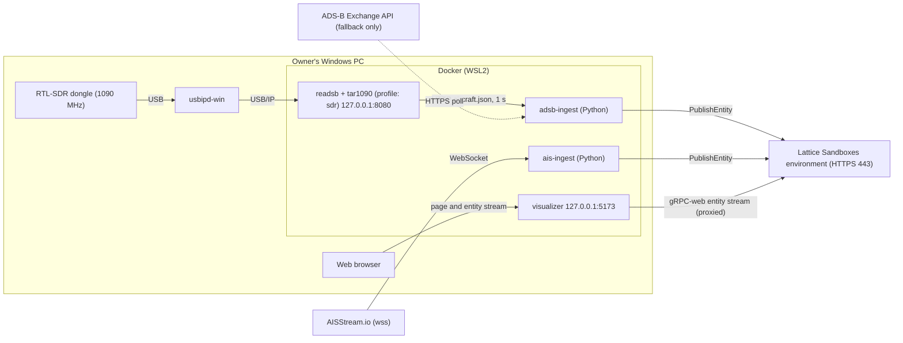
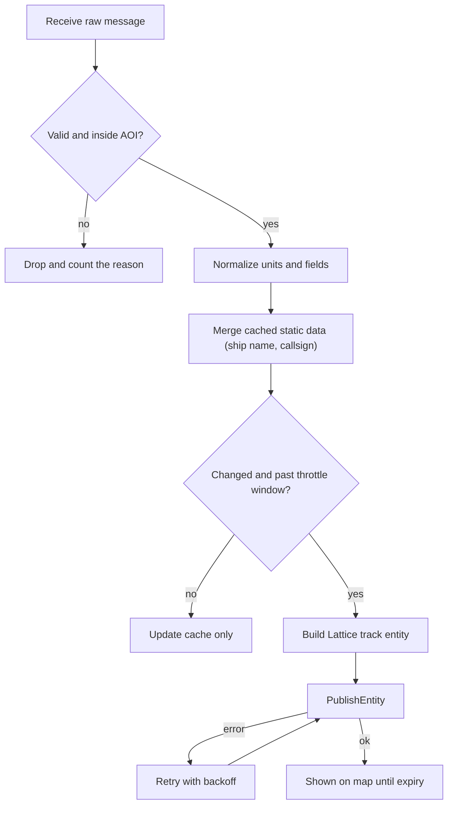

# Lattice-COP

Live Tampa Bay ships (AIS) and aircraft (ADS-B) streamed into a Lattice Sandboxes environment as track entities, and shown on a local map.

[](https://github.com/WaughB/Lattice-COP/actions/workflows/ci.yml)
[](https://github.com/WaughB/Lattice-COP/actions/workflows/ci.yml)
[](LICENSE)
[](pyproject.toml)

> Disclaimer: This is an independent personal project. It is not affiliated with, endorsed by, or sponsored by Anduril Industries. Anduril and Lattice are trademarks of Anduril Industries, Inc. This repository does not contain or redistribute the Lattice SDK; it is installed from Anduril's official package registries under Anduril's SDK License Agreement.

> Vessel data provided by aisstream.io. Aircraft data comes from the owner's own ADS-B receiver, decoded with readsb. No live data is stored in or distributed from this repository.

## Status

Work in progress. The build follows the phases in [docs/PLAN.md](docs/PLAN.md); this README grows with each phase and is completed in Phase 7.

| Phase | What | State |
| --- | --- | --- |
| 0 | Repo, CI and container scaffold | Gate passed; USB passthrough works on Docker Desktop |
| 1 | Lattice and visualizer smoke test | Gate passed |
| 2 | AISStream connection | Gate passed |
| 3 | RTL-SDR and signal gate | Not started |
| 4 | Data cleaning | Not started |
| 5 | Lattice conversion and publishing | Not started |
| 6 | Visual verification | Not started |
| 7 | Docs and hardening | Not started |

## What it does

Lattice-COP is a small containerized Python 3.14 service. It receives live AIS vessel reports from AISStream.io and live ADS-B aircraft reports from a home RTL-SDR receiver decoded by readsb. It cleans each report, converts it to a Lattice track entity, and publishes it to the owner's own Lattice Sandboxes environment. Anduril's Entity Visualizer sample app, run locally, shows the result.

The default area of interest is Tampa Bay: a box from 27.40 N, 83.00 W to 28.20 N, 82.25 W, and for aircraft a 60 nm radius around Tampa International Airport (27.9755 N, 82.5332 W). Both are configurable.

This is a personal, non-commercial project that shows Lattice SDK integration skills. It is not a product or a service.

## Architecture

Four Compose services. The two Python ingest services share one image and one package, and each runs its own pipeline end to end. There is no message broker. Everything a person opens is bound to `127.0.0.1`.

| Service | Image | Profile | Ports | Talks to |
| --- | --- | --- | --- | --- |
| `readsb` | Upstream readsb image with the tar1090 web UI, pinned by digest | `sdr` | `127.0.0.1:8080` | RTL-SDR over USB |
| `adsb-ingest` | This repo's Python image | default | none | readsb over HTTP (or ADS-B Exchange); Lattice over HTTPS |
| `ais-ingest` | This repo's Python image | default | none | AISStream over WebSocket (TLS); Lattice over HTTPS |
| `visualizer` | Built from the upstream sample app at a pinned commit | default | `127.0.0.1:5173` | Serves the page and forwards the browser's entity stream to Lattice |

### Network



### One message, start to finish



## Quick check (Phase 1)

With `LATTICE_URL` (hostname only, no `https://`), `LATTICE_SANDBOXES_TOKEN` and one set of Lattice credentials in `.env`:

```bash
# Ubuntu (WSL2): start the map, then publish one synthetic vessel for five minutes
docker compose up -d --build visualizer
docker compose run --rm ais-ingest smoke-test
```

Open <http://127.0.0.1:5173> in a Windows browser. A vessel named `LATTICE-COP SMOKE TEST` should appear in the middle of Tampa Bay and disappear five minutes later.

The visualizer puts your Lattice credentials in the page it serves. It is bound to `127.0.0.1` and must stay there.

## AIS connection check (Phase 2)

With `AISSTREAM_API_KEY` also set in `.env`:

```bash
# Ubuntu (WSL2): connect to AISStream and log message counts every 60 s. Ctrl+C stops it.
docker compose run --rm ais-ingest
```

Each minute it prints one JSON line, `AISStream message counts`, with the number of messages by type and how many position reports were inside the area of interest. Nothing is published to Lattice yet, and no vessel data is logged or stored: the logs carry counts only. If the connection drops, the service reconnects by itself, waiting between 2 and 60 seconds.

## Development

All commands run in **Ubuntu (WSL2)**.

```bash
# Ubuntu (WSL2): keep the virtualenv off the Windows drive
export UV_PROJECT_ENVIRONMENT="$HOME/.venvs/lattice-cop"
uv sync
```

```bash
# Ubuntu (WSL2): the same checks CI runs
uv run ruff check .
uv run ruff format --check .
uv run mypy
uv run pytest --cov
```

```bash
# Ubuntu (WSL2): compare your .env with .env.example (prints key names only)
uv run scripts/check-env.py
```

```bash
# Ubuntu (WSL2): install the git hooks once
uv run pre-commit install
```

Tests never touch the network, and total branch coverage must stay at or above 90%.

## Data handling

No AIS or ADS-B data is stored, archived or redistributed. Messages are held in memory only long enough to clean, convert and publish them to the owner's own Lattice Sandboxes environment. Every test fixture is synthetic: made-up MMSIs in the `999000000`-`999999999` range and made-up ICAO hex codes starting with `ffff`. A CI job enforces this.

## Credits and third-party notices

| Credit | Why | Notice |
| --- | --- | --- |
| [AISStream.io](https://aisstream.io/) | Live AIS data | Vessel data provided by aisstream.io. |
| [readsb](https://github.com/wiedehopf/readsb) by wiedehopf | ADS-B decoding | GPL-3.0-or-later. Used unmodified, in its own container. |
| [tar1090](https://github.com/wiedehopf/tar1090) by wiedehopf | Receiver web map | GPL-2.0-or-later. Used unmodified, inside the readsb container. |
| [docker-adsb-ultrafeeder](https://github.com/sdr-enthusiasts/docker-adsb-ultrafeeder) by sdr-enthusiasts | Packaging of readsb and tar1090 | GPL-3.0. Upstream image, pulled unmodified. |
| Lattice SDK and [Entity Visualizer sample app](https://github.com/anduril/sample-app-entity-visualizer) by Anduril Industries | Entities API and map app | Used under the Anduril Lattice SDK License Agreement. Not redistributed here. |
| [OpenStreetMap](https://www.openstreetmap.org/copyright) via [Leaflet](https://leafletjs.com/) | Base map in the visualizer | © OpenStreetMap contributors. Leaflet is BSD-2-Clause. |
| [usbipd-win](https://github.com/dorssel/usbipd-win) by Frans van Dorsselaer | Shares the RTL-SDR into WSL2 | GPL-3.0. Installed by the owner; not redistributed. |
| [ADS-B Exchange](https://www.adsbexchange.com/) | Fallback aircraft source, only if enabled | Personal, non-commercial use only. |

Full details are in [THIRD_PARTY_NOTICES.md](THIRD_PARTY_NOTICES.md).

## License

The original code in this repository is licensed under the [Apache License 2.0](LICENSE). See [NOTICE](NOTICE). That license covers only this repository's own code. It does not relicense the Lattice SDK, the Entity Visualizer sample app, readsb, tar1090, or any data.
