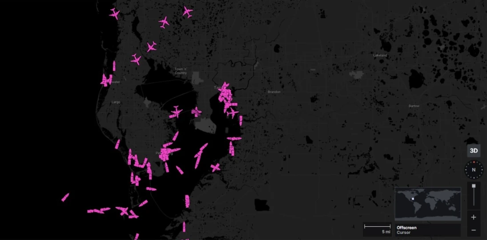
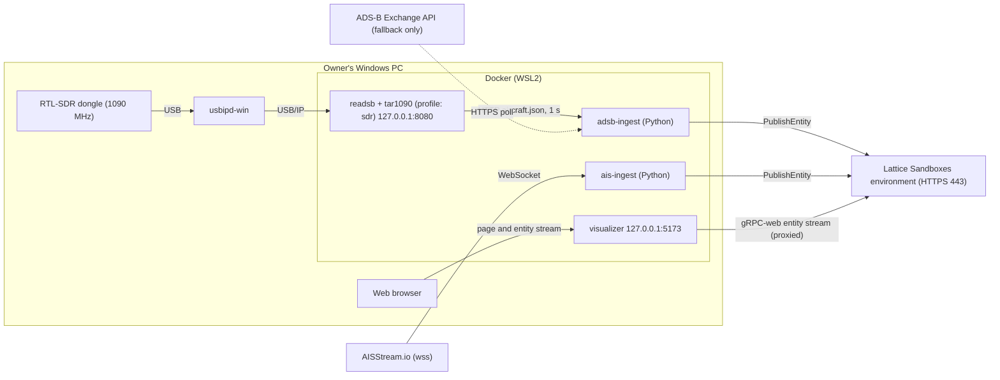
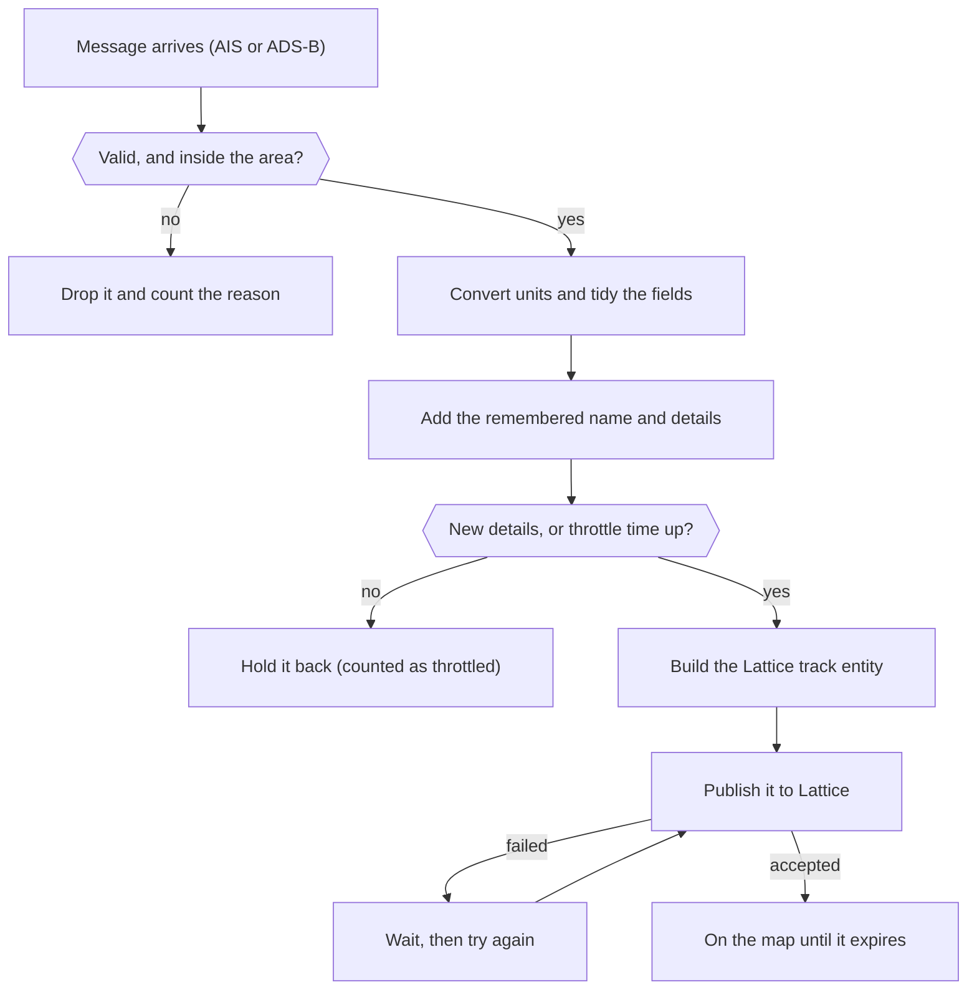
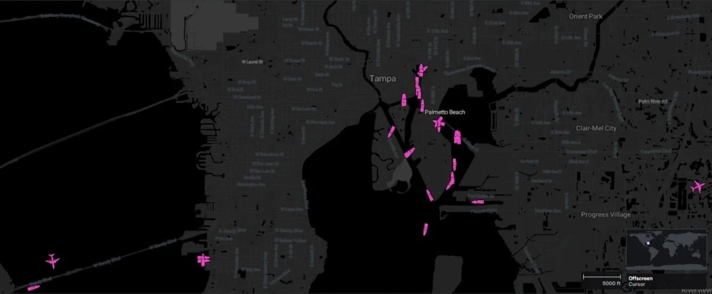
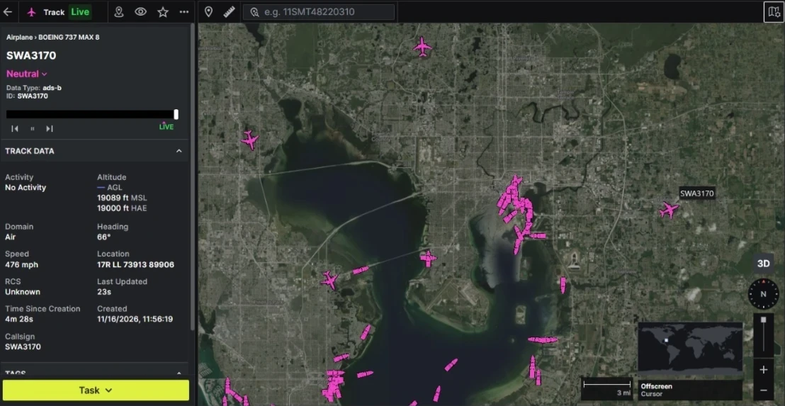

# Tampa-COP

Live Tampa Bay ships (AIS) and aircraft (ADS-B) streamed into a Lattice Sandboxes environment as track entities, and shown on a local map.

[](https://github.com/WaughB/Tampa-COP/actions/workflows/ci.yml)
[](https://github.com/WaughB/Tampa-COP/actions/workflows/ci.yml)
[](LICENSE)
[](pyproject.toml)



*Tampa Bay on 16 November 2026: ships (AIS) and the aircraft overhead (ADS-B), published by this project and shown in the Lattice UI of the owner's Sandboxes environment. Cropped to the map.*

> Disclaimer: This is an independent personal project. It is not affiliated with, endorsed by, or sponsored by Anduril Industries. Anduril and Lattice are trademarks of Anduril Industries, Inc. This repository does not contain or redistribute the Lattice SDK; it is installed from Anduril's official package registries under Anduril's SDK License Agreement.

> Vessel data provided by aisstream.io. Aircraft data comes from the owner's own ADS-B receiver, decoded with readsb. No live data is stored in or distributed from this repository.

> Aircraft type, registration and operator details come from the tar1090-db aircraft database, read by readsb.

## What it does

Tampa-COP is a small containerized Python 3.14 service. It receives live AIS vessel reports from AISStream.io and live ADS-B aircraft reports from a home RTL-SDR receiver decoded by readsb. It cleans each report, converts it to a Lattice track entity, and publishes it to the owner's own Lattice Sandboxes environment. Anduril's Entity Visualizer sample app, run locally, shows the result.

The default area of interest is Tampa Bay: a box from 27.40 N, 83.00 W to 28.20 N, 82.25 W, and for aircraft a 60 nm radius around Tampa International Airport (27.9755 N, 82.5332 W). Both are configurable.

This is a personal, non-commercial project that shows Lattice SDK integration skills. It is not a product or a service. It was built in gated phases; [docs/PLAN.md](docs/PLAN.md) has the checklist and [docs/DECISIONS.md](docs/DECISIONS.md) the decisions made along the way.

## Architecture

Four Compose services. The two Python ingest services share one image and one package, and each runs its own pipeline end to end. There is no message broker. Everything a person opens is bound to `127.0.0.1`.

| Service | Image | Profile | Ports | Talks to |
| --- | --- | --- | --- | --- |
| `readsb` | Upstream readsb image with the tar1090 web UI, pinned by digest | `sdr` | `127.0.0.1:8080` | RTL-SDR over USB |
| `adsb-ingest` | This repo's Python image | default | none | readsb over HTTP (or ADS-B Exchange); Lattice over HTTPS |
| `ais-ingest` | This repo's Python image | default | none | AISStream over WebSocket (TLS); Lattice over HTTPS |
| `visualizer` | Built from the upstream sample app at a pinned commit | default | `127.0.0.1:5173` | Serves the page and forwards the browser's entity stream to Lattice |

### Network



### One message, start to finish



## Prerequisites

**Hardware**

- An RTL-SDR USB dongle (RTL2832U; [buying guide](https://www.rtl-sdr.com/buy-rtl-sdr-dvb-t-dongles/)). The scripts expect USB ID `0bda:2838` and take another ID as a parameter.
- A 1090 MHz antenna. The small whip that comes with most dongles is enough to pass the signal check from a window.
- Without a dongle you can still run the ship half of the project.

**Software**

- Windows 11 with [WSL2 and Ubuntu](https://learn.microsoft.com/en-us/windows/wsl/install).
- [Docker Desktop with WSL integration](https://docs.docker.com/desktop/features/wsl/) turned on for Ubuntu.
- [usbipd-win](https://github.com/dorssel/usbipd-win), which shares the dongle from Windows into WSL2.
- Git. For development only: [uv](https://docs.astral.sh/uv/getting-started/installation/).

**Accounts**

- An Anduril [Lattice Sandboxes](https://sandboxes.developer.anduril.com/) account, through the [Lattice Developer Program](https://developer.anduril.com/). Read the program's terms before you publish anything about your environment.
- A free [AISStream.io](https://aisstream.io/) account and API key.

## Setup

Every command says which shell it runs in. Ubuntu commands run from the repo folder.

1. **Clone the repo.**

   ```bash
   # Ubuntu (WSL2)
   git clone https://github.com/WaughB/Tampa-COP.git
   cd Tampa-COP
   ```

2. **Create your settings file.** `.env` is ignored by git. Never commit it.

   ```bash
   # Ubuntu (WSL2)
   cp .env.example .env
   ```

3. **Fill in the credentials** in `.env`:

   | Setting | Where it comes from |
   | --- | --- |
   | `LATTICE_URL` | The Sandboxes dashboard: the hostname of your running environment, without `https://`. |
   | `LATTICE_SANDBOXES_TOKEN` | The Sandboxes dashboard: your account's Sandboxes token. It stays the same from one environment to the next. |
   | `LATTICE_CLIENT_ID` and `LATTICE_CLIENT_SECRET`, or `LATTICE_ENVIRONMENT_TOKEN` | The environment's details page. Fill in the pair or the token, not both. |
   | `AISSTREAM_API_KEY` | Your [AISStream account page](https://aisstream.io/authenticate). |
   | `RECEIVER_LAT`, `RECEIVER_LON`, `RECEIVER_ALT_M` | Your antenna's location, and its height above sea level in metres. This is your home: it stays in `.env` and is never committed. |

   Sandboxes environments are time-limited (two hours in this project's experience). A new environment has a new hostname and new credentials; see [the troubleshooting guide](docs/TROUBLESHOOTING.md#401-403-or-412-from-lattice) for the three lines to change.

4. **Share the dongle into WSL2.** Install usbipd-win once, then run the attach script and leave its window open. It re-attaches the dongle after an unplug.

   ```powershell
   # Windows PowerShell (run as Administrator), once
   winget install usbipd
   ```

   ```powershell
   # Windows PowerShell (run as Administrator), from the repo folder
   .\scripts\windows\attach-sdr.ps1
   ```

5. **Check the setup.** The preflight script checks Docker, `.env` and the dongle, and prints no secret values. The smoke test then publishes one synthetic vessel.

   ```bash
   # Ubuntu (WSL2)
   scripts/wsl/preflight.sh
   ```

   ```bash
   # Ubuntu (WSL2): start the map, then publish a test vessel for five minutes
   docker compose up -d --build visualizer
   docker compose run --rm ais-ingest smoke-test
   ```

   Open <http://127.0.0.1:5173> in a Windows browser. A vessel named `TAMPA-COP SMOKE TEST` should appear in the middle of Tampa Bay and disappear five minutes later.

6. **Run the receiver signal check.** Do this in daytime, when there is more traffic.

   ```bash
   # Ubuntu (WSL2): start the receiver
   docker compose --profile sdr up -d readsb
   ```

   Open <http://127.0.0.1:8080>. Aircraft should appear on the receiver's own map (tar1090) within a minute or two. The map shows no marker for your antenna; that is deliberate.

   ```bash
   # Ubuntu (WSL2): watches for 30 minutes and prints a pass/fail report
   docker compose --profile sdr run --rm adsb-ingest sdr-check
   ```

   Add `--minutes 5` for a quick look; only a full run counts. The pass marks are the `SDR_CHECK_*` settings:

   | Check | Default pass mark |
   | --- | --- |
   | Unique aircraft with a position inside the area of interest | at least 20 |
   | Median position age (`seen_pos`) | 5 s or less |
   | Farthest position from the antenna | at least 30 nm |
   | USB dropouts and readsb restarts | none |

   If it fails, move the antenna and run it again:

   - Stand the whip antenna vertical.
   - Put it as high as you can and next to a window, with a view of the sky.
   - Keep it away from the PC, monitors and USB 3 devices; a USB extension lead helps.
   - Try more than one spot and compare results. A few feet can change the range a lot.

7. **Start everything.**

   ```bash
   # Ubuntu (WSL2): receiver, both ingest services and the map
   docker compose --profile sdr up -d --build
   ```

   Without a dongle, leave out `--profile sdr`: ships still appear, and `adsb-ingest` waits for a receiver.

8. **Open the map** at <http://127.0.0.1:5173>.

The map app puts your Lattice credentials in the page it serves. It is bound to `127.0.0.1` and must stay there. The receiver container sends nothing to any flight-tracking network and keeps nothing on disk.

## Verify

**On the map (<http://127.0.0.1:5173>)**

- Ships across Tampa Bay within a minute or two, and aircraft within seconds of the receiver hearing them. Hover over a marker for its name.
- A ship shows as `MMSI` and its number until its name has been received, which can take six minutes.
- An aircraft shows its callsign, else its registration, else its ICAO hex code, and sits where the receiver's own map (<http://127.0.0.1:8080>) shows it.
- A ship stays for 10 minutes after its last report and an aircraft for 60 seconds. Stop a service and its tracks disappear by themselves.
- In the Lattice UI each ship and aircraft icon points along its heading:

  

  *Ships in the channels of Port Tampa Bay, with aircraft passing over.*

- The sample map app shows a plain marker and a name. Icons, heading and the aircraft details below are visible in the Lattice UI of your environment (open the environment's hostname in a browser and sign in with the user and password from its details page).

**In the logs**

```bash
# Ubuntu (WSL2): each ingest service logs one JSON line of counters every 60 seconds
docker compose logs -f ais-ingest adsb-ingest
```

The lines to look for are `ais-ingest counts` and `adsb-ingest counts`. All counters run from the start of the service.

| Counter | Meaning |
| --- | --- |
| `stream.total_messages`, `stream.positions_in_aoi` | AIS only: messages received from AISStream, and position reports inside the area. |
| `stream.connections_opened` | AIS only: 1 means the connection has never dropped. |
| `polls.polls`, `polls.failed_polls` | ADS-B only: reads of the receiver's `aircraft.json`, one a second, and how many failed. |
| `clean.kept` | Reports that passed every cleaning rule. |
| `clean.static_cached` | AIS only: name and size messages remembered for later position reports. |
| `clean.<reason>` | Reports dropped, by reason: `outside_aoi`, `stale`, `duplicate`, `position_jump`, `invalid_position`, `no_position`, `non_icao`, `mmsi_not_vessel` and so on. |
| `publish.published` | Updates Lattice accepted. |
| `publish.throttled` | Updates held back because the same track was sent less than 10 s (ships) or 2 s (aircraft) ago. |
| `publish.retried` | Updates sent again after a timeout, a 429 or a 5xx answer. |
| `publish.rejected`, `publish.failed` | Updates Lattice refused (4xx), and updates given up on after four attempts. A handful is normal; a steady climb is not. |
| `vessels_tracked`, `aircraft_tracked` | Ships or aircraft currently remembered. |
| `backlog` | Updates waiting to be sent. It should stay near 0. |

A healthy system has `publish.published` growing every minute and `publish.failed` at 0. The logs carry counts only: no vessel or aircraft data, and never a secret.

### What each aircraft carries

Besides position, height, speed and heading, each aircraft entity carries what the receiver hears and what readsb's built-in aircraft database knows:

| Lattice field | Content | From |
| --- | --- | --- |
| `aliases.name` | Callsign, else registration, else ICAO hex | Receiver, database |
| `aliases.alternate_ids` | Callsign and registration | Receiver, database |
| `ontology.specific_type` | Type, such as `BOEING 737-800` | Database |
| `transponder_codes` | Mode S address and flight ID, squawk, barometric altitude | Receiver |
| `indicators.emergency` | True for squawk 7500, 7600 or 7700, or an ADS-B emergency state | Receiver |
| `description` | All of the above in words, plus airline, operator, build year, size class, selected altitude and whether the aircraft is military | Both |



*One aircraft selected in the Lattice UI. The line `Airplane › BOEING 737 MAX 8` matches `ontology.platform_type` and `specific_type`; callsign, data type, altitude, heading and speed are below it.*

The Entity Visualizer shows only the name. The other fields are visible in the Lattice UI of your Sandboxes environment and through the Entities API. The airline is the one the callsign belongs to: `adsb-ingest` reads tar1090's airline table from the readsb container and looks up the first three letters of a callsign shaped like a flight number. The operator is the registered owner or operator, which for an airliner is often a leasing trust. Both databases are the copies built into the readsb image, so new aircraft and airlines may be missing. Nothing is looked up on the internet, and there is no route (origin and destination): the free route sources do not allow their data to be passed on. Owner names are left out for aircraft in the FAA's LADD and PIA privacy programmes.

## Teardown

```bash
# Ubuntu (WSL2): stop and remove the containers and volumes. Tracks already in Lattice expire by themselves.
docker compose --profile sdr down -v
```

```powershell
# Windows PowerShell: close the attach-sdr.ps1 window first, then give the dongle back to Windows
.\scripts\windows\detach-sdr.ps1
```

```bash
# Ubuntu (WSL2): also remove the images, if you are done with the project
docker compose --profile sdr down -v --rmi all
```

If the project is ending, also revoke or rotate the Sandboxes token, the environment token or client secret, and the AISStream API key, each on its own dashboard, and delete `.env`.

## Configuration reference

Every setting lives in `.env`. [.env.example](.env.example) lists them all with the same defaults.

**Lattice and AISStream**

| Variable | Default | Meaning |
| --- | --- | --- |
| `LATTICE_URL` | none (required) | Environment hostname, without `https://`. |
| `LATTICE_SANDBOXES_TOKEN` | none (required) | Account-level Sandboxes token, sent as the `Anduril-Sandbox-Authorization` header. |
| `LATTICE_ENVIRONMENT_TOKEN` | empty | Environment bearer token. Use this or the client ID and secret, not both. |
| `LATTICE_CLIENT_ID` | empty | Client ID, used with the secret below. |
| `LATTICE_CLIENT_SECRET` | empty | Client secret. |
| `AISSTREAM_API_KEY` | none (required) | AISStream API key. |

**Area of interest**

| Variable | Default | Meaning |
| --- | --- | --- |
| `AOI_SOUTH`, `AOI_WEST`, `AOI_NORTH`, `AOI_EAST` | `27.40`, `-83.00`, `28.20`, `-82.25` | The box, in degrees. Ships and aircraft outside it are dropped. |
| `ADSB_CENTER_LAT`, `ADSB_CENTER_LON` | `27.9755`, `-82.5332` | Centre of the aircraft radius (Tampa International Airport). |
| `ADSB_RADIUS_NM` | `60` | Aircraft farther than this from the centre are dropped. |

**Aircraft source**

| Variable | Default | Meaning |
| --- | --- | --- |
| `ADSB_SOURCE` | `receiver` | `receiver` is your RTL-SDR through readsb. `adsbx` (ADS-B Exchange) is reserved for a fallback that is not built. |
| `ADSB_RECEIVER_URL` | `http://readsb/data/aircraft.json` | Where `adsb-ingest` reads aircraft from. |
| `RECEIVER_LAT`, `RECEIVER_LON` | empty | Antenna location, in degrees. Private. Used by readsb and by `sdr-check` for range. |
| `RECEIVER_ALT_M` | empty | Antenna height above sea level, in metres. |
| `ADSBX_RAPIDAPI_KEY`, `ADSBX_POLL_SECONDS`, `ADSBX_MONTHLY_QUOTA` | empty, `60`, empty | ADS-B Exchange settings. Checked but unused while the fallback is not built. |

**Receiver signal check**

| Variable | Default | Meaning |
| --- | --- | --- |
| `SDR_CHECK_MINUTES` | `30` | How long `sdr-check` watches. |
| `SDR_CHECK_MIN_AIRCRAFT` | `20` | Fewest unique aircraft inside the area to pass. |
| `SDR_CHECK_MAX_MEDIAN_SEEN_POS` | `5` | Highest median position age to pass, in seconds. |
| `SDR_CHECK_MIN_RANGE_NM` | `30` | Shortest farthest-aircraft distance to pass, in nautical miles. |

**Cleaning rules**

| Variable | Default | Meaning |
| --- | --- | --- |
| `AIS_MAX_AGE_SECONDS` | `300` | Ship messages older than this are dropped. |
| `AIS_MAX_SPEED_KN` | `50` | A ship position that implies a higher speed since the last one is dropped as a jump. |
| `AIS_ALLOW_NON_VESSEL_MMSI` | `false` | `true` also keeps coast stations, navigation aids, rescue aircraft and beacons. |
| `AIS_STATIC_CACHE_SECONDS` | `21600` | How long a ship's name, call sign, type, size and destination are remembered. |
| `ADSB_MAX_POSITION_AGE_SECONDS` | `15` | Aircraft positions older than this are dropped. |
| `ADSB_MAX_SPEED_KN` | `1000` | An aircraft position that implies a higher speed since the last one is dropped as a jump. |
| `ADSB_ALLOW_NON_ICAO` | `false` | `true` also keeps addresses that are not ICAO-assigned, such as TIS-B tracks. |
| `POSITION_JUMP_SLACK_NM` | `0.1` | Extra distance allowed before a move counts as a jump. |

**Tuning**

| Variable | Default | Meaning |
| --- | --- | --- |
| `AIS_EXPIRY_SECONDS` | `600` | How long a ship stays in Lattice after its last update. |
| `ADSB_EXPIRY_SECONDS` | `60` | How long an aircraft stays in Lattice after its last update. |
| `AIS_THROTTLE_SECONDS` | `10` | Shortest time between two updates of the same ship. A new name goes out at once. |
| `ADSB_THROTTLE_SECONDS` | `2` | Shortest time between two updates of the same aircraft. |
| `GEOID_OFFSET_M` | `-26.7` | Geoid height at Tampa. Added to barometric altitude when an aircraft sends no geometric altitude. |
| `PUBLISH_CONCURRENCY` | `2` | Updates each service sends to Lattice at the same time. Sandboxes environments reject bursts, so keep it low. |
| `LOG_LEVEL` | `INFO` | Log detail: `DEBUG`, `INFO`, `WARNING` or `ERROR`. |

## Development

All commands run in **Ubuntu (WSL2)**.

```bash
# Ubuntu (WSL2): keep the virtualenv off the Windows drive
export UV_PROJECT_ENVIRONMENT="$HOME/.venvs/tampa-cop"
uv sync
```

```bash
# Ubuntu (WSL2): the same checks CI runs
uv run ruff check .
uv run ruff format --check .
uv run mypy
uv run pytest --cov --cov-report=term-missing
```

```bash
# Ubuntu (WSL2): compare your .env with .env.example (prints key names only)
uv run scripts/check-env.py
```

```bash
# Ubuntu (WSL2): install the git hooks once
uv run pre-commit install
```

Tests never touch the network: AISStream, readsb and Lattice are mocked. Total branch coverage must stay at or above 90%, and the cleaning rules at or above 95%; `--cov-report=term-missing` prints the report with any uncovered lines. CI also scans for secrets, audits the Python dependencies, builds both images and scans them for vulnerabilities, renders the diagrams and checks every link. No image is ever pushed to a registry.

## Troubleshooting

[docs/TROUBLESHOOTING.md](docs/TROUBLESHOOTING.md) covers the dongle not attaching, no aircraft, no ships, the AISStream WebSocket closing, 401 and 403 answers from Lattice, an environment that has ended, and tracks blinking out.

## Data handling

No AIS or ADS-B data is stored, archived or redistributed. Messages are held in memory only long enough to clean, convert and publish them to the owner's own Lattice Sandboxes environment. Every test fixture is synthetic: made-up MMSIs in the `999000000`-`999999999` range and made-up ICAO hex codes starting with `ffff`. A CI job enforces this.

The three screenshots in `docs/img/` are the one exception: each is a single moment of live traffic, added with the owner's approval. They show the Lattice UI, which is Anduril's software, only to illustrate what this project publishes; they are cropped to the map and track panel.

## Credits and third-party notices

| Credit | Why | Notice |
| --- | --- | --- |
| [AISStream.io](https://aisstream.io/) | Live AIS data | Vessel data provided by aisstream.io. |
| [readsb](https://github.com/wiedehopf/readsb) by wiedehopf | ADS-B decoding | GPL-3.0-or-later. Used unmodified, in its own container. |
| [tar1090](https://github.com/wiedehopf/tar1090) by wiedehopf | Receiver web map | GPL-2.0-or-later. Used unmodified, inside the readsb container. |
| [docker-adsb-ultrafeeder](https://github.com/sdr-enthusiasts/docker-adsb-ultrafeeder) by sdr-enthusiasts | Packaging of readsb and tar1090 | GPL-3.0. Upstream image, pulled unmodified. |
| [tar1090-db](https://github.com/wiedehopf/tar1090-db) by wiedehopf, from the aircraft database maintained by [Mictronics](https://github.com/Mictronics/readsb) | Aircraft type, registration, operator and build year; airline names by ICAO code | Read by readsb and by `adsb-ingest` from the copy inside the upstream image. Not stored in or redistributed from this repository. |
| Lattice SDK and [Entity Visualizer sample app](https://github.com/anduril/sample-app-entity-visualizer) by Anduril Industries | Entities API and map app | Used under the Anduril Lattice SDK License Agreement. Not redistributed here. |
| [OpenStreetMap](https://www.openstreetmap.org/copyright) via [Leaflet](https://leafletjs.com/) | Base map in the visualizer | © OpenStreetMap contributors. Leaflet is BSD-2-Clause. |
| [usbipd-win](https://github.com/dorssel/usbipd-win) by Frans van Dorsselaer | Shares the RTL-SDR into WSL2 | GPL-3.0. Installed by the owner; not redistributed. |
| [ADS-B Exchange](https://www.adsbexchange.com/) | Fallback aircraft source, only if enabled | Personal, non-commercial use only. |

Full details are in [THIRD_PARTY_NOTICES.md](THIRD_PARTY_NOTICES.md).

## License

The original code in this repository is licensed under the [Apache License 2.0](LICENSE). See [NOTICE](NOTICE). That license covers only this repository's own code. It does not relicense the Lattice SDK, the Entity Visualizer sample app, readsb, tar1090, or any data.
